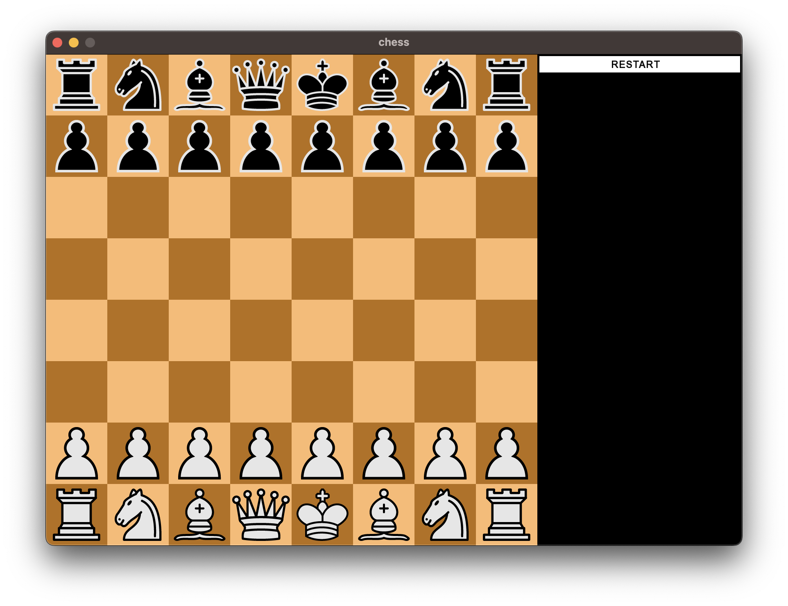
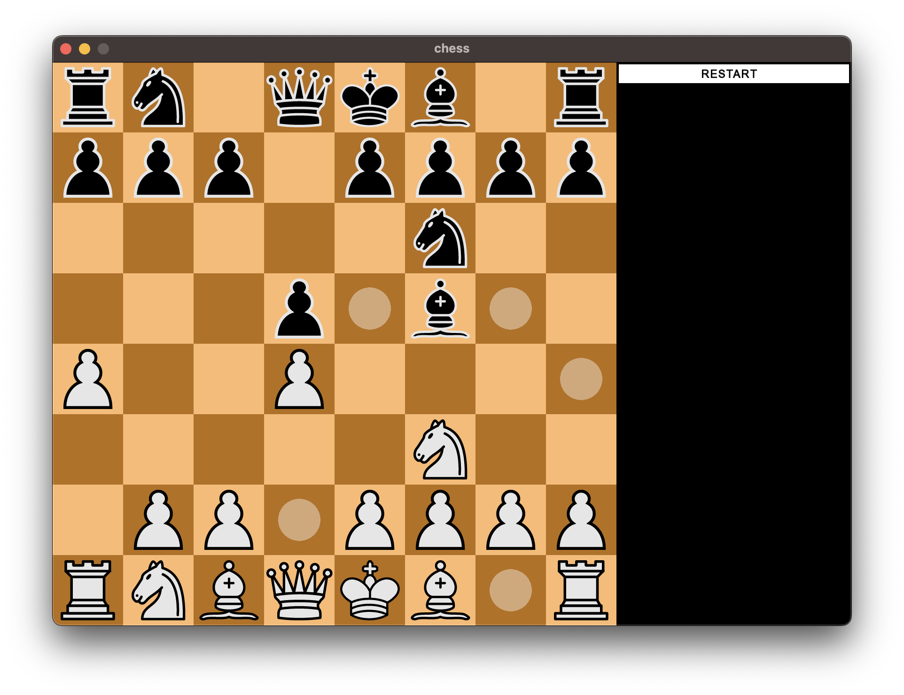
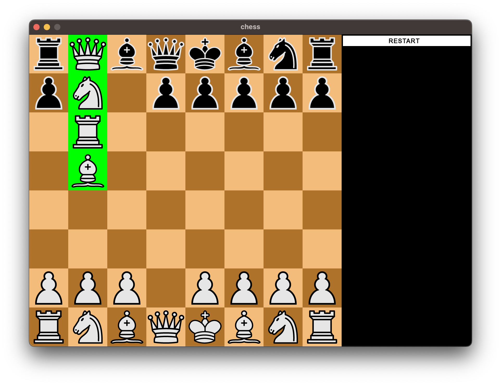
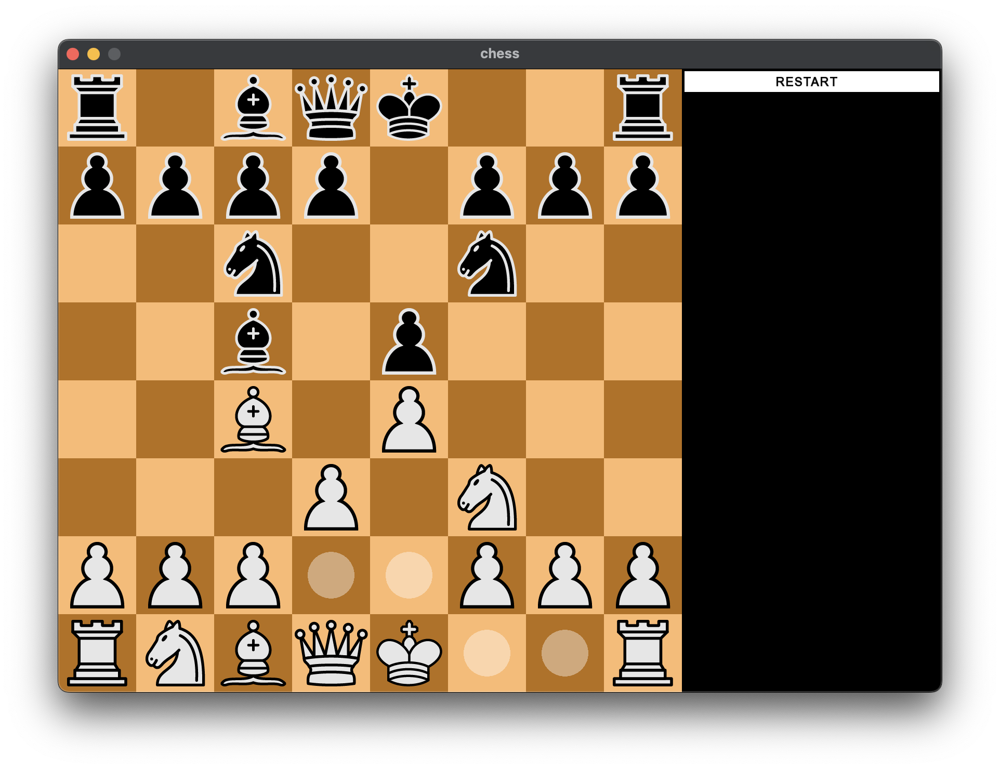
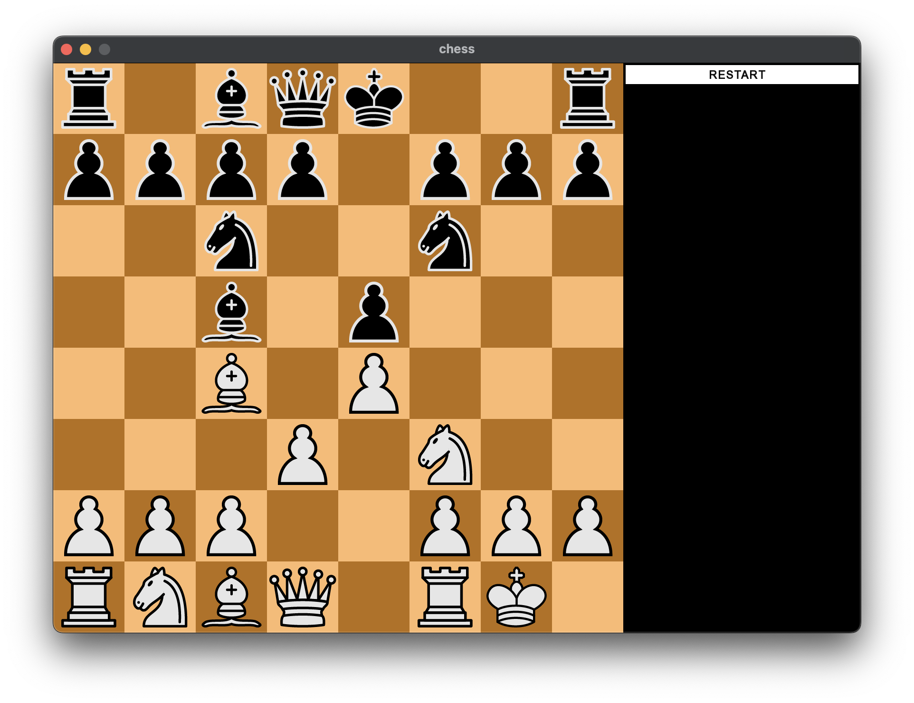

# Chess

This is a simple chess game implemented in C++17 using the SFML for graphics rendering and user interaction.

## Features

- Standard chess rules implemented
- Graphical user interface using SFML
- Human vs. Human gameplay
- Minimalistic design for ease of understanding and extension

## Screenshots








## Requirements

- C++ compiler supporting C++17
- CMake 3.16 or newer
- SFML 2.6 development package (graphics, window, and system libraries)

## Installation

1. Clone this repository:

    ```bash
    git clone https://github.com/whoami13579/chess.git
    ```

2. Build the project using CMake:

    ```bash
    cd chess
    cmake -S . -B build
    cmake --build build
    ```

## Usage

After building the project, you can run the executable to start the game:

```bash
./build/chess
```

On multi-configuration generators, the executable is in a configuration subdirectory such as `build/Debug/`. Assets load from the directory selected at configure time. If you move the checkout or keep assets elsewhere, reconfigure with `-DCHESS_ASSET_DIR=/path/to/Textures`.

## Environment check

On Linux or macOS, run the local check. It first checks for CMake and a C++ compiler, then verifies SFML and all required assets, builds the project, and runs the rule tests:

```bash
./scripts/check-environment.sh
```

The check builds in `build/environment-check`. To use another build directory, run `./scripts/check-environment.sh -DCHESS_CHECK_BUILD_DIR=/path/to/build`. On Windows, run `cmake -P cmake/CheckEnvironment.cmake` after installing CMake and a C++17 compiler.

## Code tests

Run the move-legality tests directly with CTest:

```bash
cmake -S . -B build
cmake --build build
cd build
ctest --output-on-failure
```
